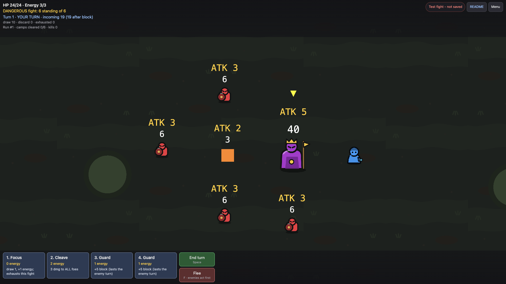
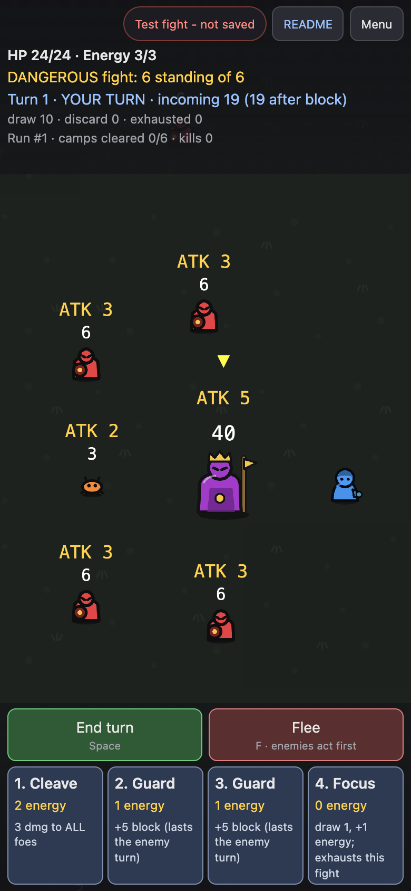

# Camp Clearer

A small card-battle trek for a handful of friends: walk the map, choose which
enemies to pull into each fight, read their next move, and play your hand.
It is for people who like a short tactics puzzle (Slay the Spire, Into the
Breach) and want to stop mid-run and pick it up later, on a laptop or phone.

## What good means here

**Enforced** means a test fails if it breaks; **judged** means I check it by playing.

1. **Thinking is free.** Nothing happens during your turn until you end it: no
   timers, no regeneration, no enemy moves. *Enforced:* `src/turn.test.ts`,
   `src/combat.test.ts` and a browser check.
2. **You choose the size and place of every fight.** Loners can be split; a
   pack chases and joins together. *Enforced:* `src/encounter.test.ts`,
   `src/roam.test.ts`. *Judged:* whether it feels predictable.
3. **Every enemy's next move is readable,** with real numbers. Nothing
   overlaps at 1920x1080 or 390x844; big fights use a side list instead of
   shrinking. *Enforced:* `src/combat.test.ts`, `src/formation.test.ts`.
4. **Each enemy changes your plan.** Swarmlings reward Cleave, a mage makes
   you choose between it and its grunts. *Judged* in play.
5. **Fleeing is honest.** Enemies still take their shown actions before you
   escape. *Enforced:* phase and combat tests.
6. **Your run is still there tomorrow.** "Saved" appears only after the
   server confirms, and a killed enemy can't come back. *Enforced:*
   `src/net.test.ts`, `spec/saves.test.ts`, `tools/persistence-check.sh`.

## Playing with a friend

At [the co-op page](/coop.html) you create an expedition and share its invite
link. There are no accounts: your browser is who you are, so the same browser
picks up where you left off, while clearing cookies makes you a new person.
You share one map; walking near a camp pulls in teammates within 320px into
the same fight. You see each other's position and the fight, but your hand
stays yours until you play it. *Enforced:* `spec/coop-auth.test.ts`,
`server/coop/ws.test.ts`. A
[multi-user test session](multi-user-test-report.md), driven by an agent
with two independent connections, confirmed joining, late joining and a
server restart mid-fight. It shows the mechanism works; no human playtest
with two people has happened yet.

## What I didn't build

No accounts, loot or talents. The art is a first sample, not a full set. The
app runs as one process on one machine with one storage volume; scaling to
two machines broke joins (11 of 20 returned 404), so that limit is accepted.

## Where these ideas came from

**My playtests.** v1 let me move during combat, and it felt like an action
grinder, so combat became strict turns. Crowding made intents overlap, which
led to the formation step.

**What I read.**

- Robin Sloan, [An app can be a home-cooked meal](https://www.robinsloan.com/notes/home-cooked-app/):
  software for a few known people can skip accounts, hence cookie identity.
- [Slay the Spire's development](https://en.wikipedia.org/wiki/Slay_the_Spire):
  telegraphed Intents made card choices meaningful; promise 3 comes from this.
- Justin Ma on [Into the Breach](https://www.gamedeveloper.com/game-platforms/road-to-the-igf-subset-games-i-into-the-breach-i-):
  "every death felt like your own fault", which is why fleeing still
  resolves the shown attacks.
- [WCAG 2.2 Target Size](https://www.w3.org/WAI/WCAG22/Understanding/target-size-minimum.html):
  the 24px floor I hold the phone controls well above.
